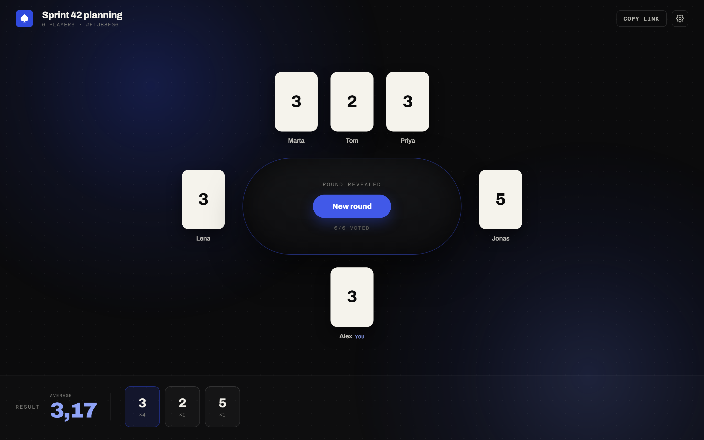
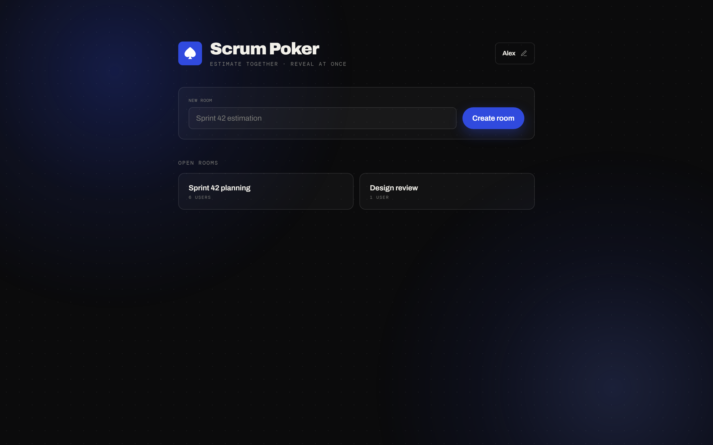
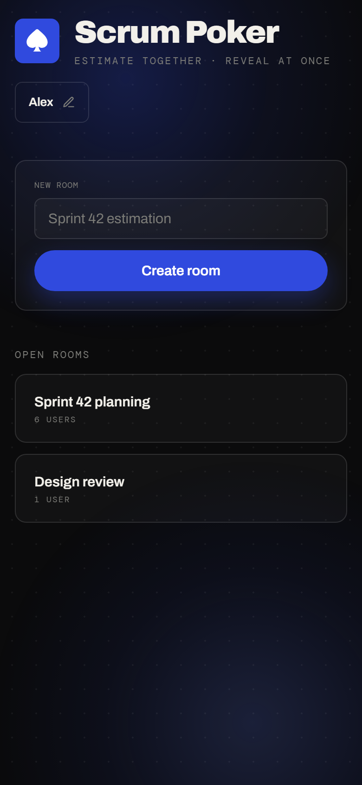
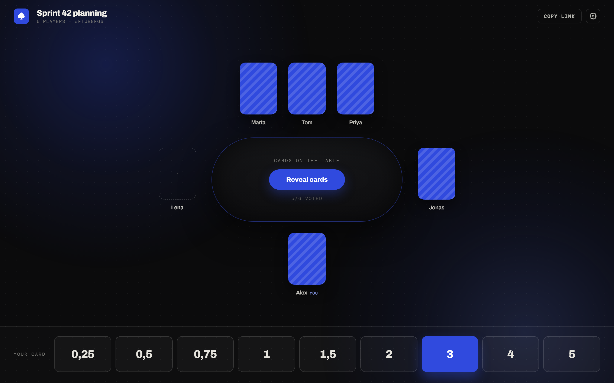
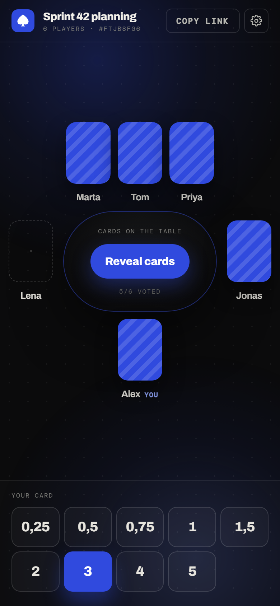
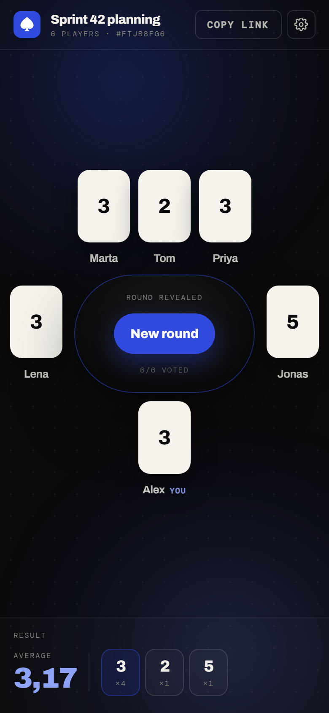

# Scrum Poker

Simple planning poker for estimating with your team. No sign-up, no ads.

**Try it:** https://scrum-poker-kc73.onrender.com/ (free hosting, so the first visit can take
about a minute to wake up)



## Why

When we searched for "scrum poker" at work, the top results were either limited or full of ads.
So this started as a quick side project for my team: create a room, share the link, everyone
picks a card, reveal together.

## Features

- Create a room in one click and share it with a link
- Votes stay hidden until someone reveals; the server never sends them to other browsers early
- Each room picks its own deck from `0 · 0,25 · 0,5 · 0,75 · 1 · 1,5 · 2 · 3 · 4 · 5 · 8 · 13 · ? · ☕`
- Average and vote count shown after each reveal
- Refresh or lose connection without losing your seat or your vote
- Number keys pick a card, and it works on phones

## Screenshots

| Desktop                                                                                | Mobile                                                                                           |
| -------------------------------------------------------------------------------------- | ------------------------------------------------------------------------------------------------ |
|            |            |
|  |  |
|  |  |

## Good to know

- No accounts and no database. Rooms live in memory and are gone when the server restarts or
  goes to sleep.
- There is no login, so anyone with the link can see and join any room. Don't put anything
  sensitive in a room name.

## Run it locally

Needs Node 22+ and pnpm.

```bash
pnpm install
pnpm dev
```

Open http://localhost:5173. For a production build, run `pnpm build && pnpm start`, which serves
everything on http://localhost:3001.

## Tech

React, Vite and Tailwind CSS on the front. Node, Express and Socket.IO on the back. TypeScript
throughout, tested with Vitest and Playwright. Deployed as a single Docker container on Render
(see `render.yaml`).

```bash
pnpm test        # rules, including hidden votes
pnpm e2e         # the same rules in two real browsers
pnpm typecheck
pnpm lint
```
